# Ajaia Docs

A lightweight collaborative document editor for product and engineering teams, inspired by Google Docs. Write specs, RFCs and status updates with rich text, import existing files, and share them with teammates as viewers or editors.

> Built for the Ajaia AI-Native Full Stack assessment ([brief](docs/assignment-brief.md)).

**Live app:** https://ajaia-docs-hz3d.onrender.com (free tier: the first visit after idling can take ~50 s while the server wakes up)
**Demo accounts** (password `demo1234` for all, or use the one-click buttons on the login page):

| Account | Starts with |
|---|---|
| `alice@ajaia.dev` | Owns "Welcome to Ajaia Docs", shared with Bob as editor |
| `bob@ajaia.dev` | Sees the welcome document under **Shared with me** |
| `carol@ajaia.dev` | No documents (good for testing sharing from scratch) |

To try sharing, sign in as two people in different browsers (or one normal + one private window).

## Features

- **Documents:** create, rename (inline title), edit, delete; reopen with formatting intact.
- **Templates for tech teams:** start a document from a feature spec, technical design (RFC), client feature presentation, status update for management, or incident postmortem.
- **Rich text:** headings (H1–H3), bold, italic, underline, strikethrough, bulleted and numbered lists, quotes, code blocks, undo/redo, keyboard shortcuts.
- **Canvas around the page:** the dotted background is a whiteboard (Excalidraw). Click **Draw** to show the drawing tools (Esc, **Done drawing** or clicking the page returns to writing). Drag a drawing onto the page — or click **Include in document** — to embed it; select it again and the same button becomes **Remove from document**. The page can be dragged around the canvas, locked in place, or reset. Drawings are saved with the document and visible to everyone with access (read-only for viewers). Screens narrower than 768 px use the classic layout.
- **A4 pages, exported as edited:** the sheet is A4 with 25 mm margins and shows dashed page-break guides while you type. **Export PDF** prints exactly that layout (same line and page breaks), without the canvas and without the browser's header/footer.
- **Fonts:** default IBM Plex Sans plus Arial, Times New Roman, Georgia, Roboto and Courier New.
- **Diagrams as code:** insert a Mermaid diagram (flowchart, sequence, ER…) and edit it with a live preview. ` ```mermaid ` blocks in imported Markdown become diagrams.
- **Autosave** with a visible status, `Ctrl/Cmd+S`, and protection against overwriting someone else's newer save.
- **File import:** upload **`.txt`, `.md` or `.docx` (max 5 MB)** to create a new editable document. Headings, emphasis, lists, images (embedded) and Mermaid code fences are preserved; tables in `.docx` are flattened to text.
- **Sharing:** the owner shares by email as **Can edit** or **View only**, changes roles, or removes access. Lists are split into **My documents** and **Shared with me**; viewers get a read-only editor.
- **Team workspaces:** create a team for a project and add colleagues by email. Pick the team on the documents page to see its documents; new, template and imported documents created there belong to the team, and **every member can edit them** without per-document sharing. One person can be in several teams (demo: Alice is in *Mobile app* with Bob and *Platform* with Carol).

## Screenshots

| Editor | Sharing |
|---|---|
| 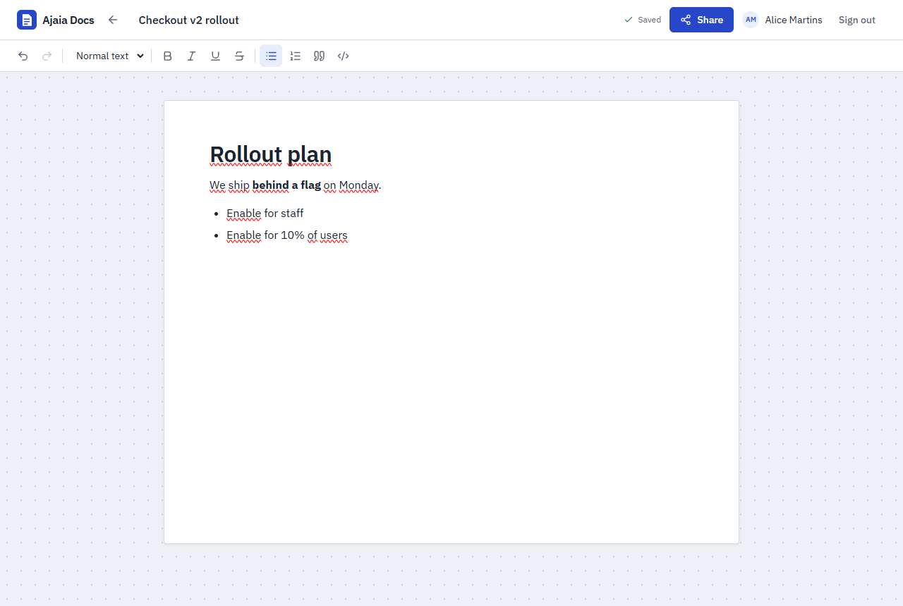 | 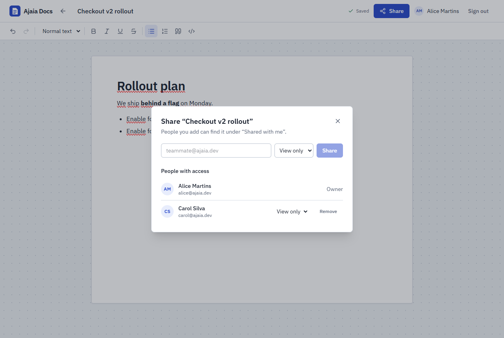 |
| **Shared with me** (recipient's view) | **View-only** access |
| 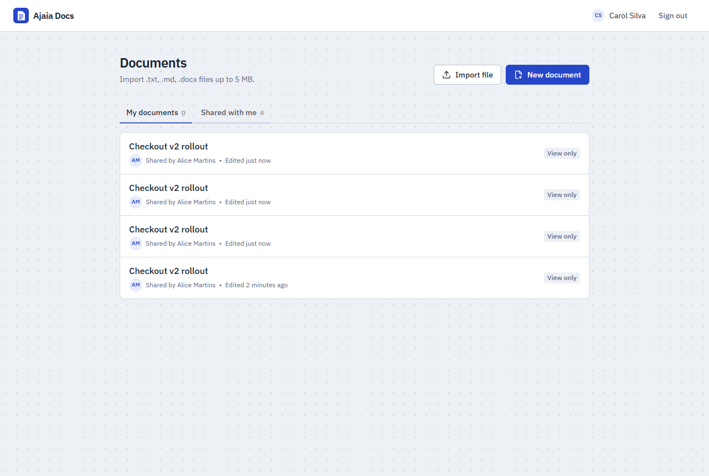 | 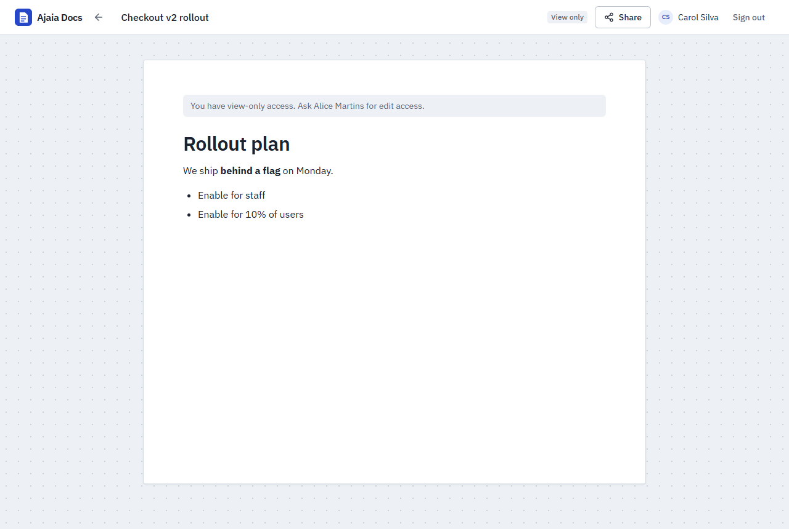 |
| **Team workspace** (one person, several projects) | **Team members** (add by email) |
| 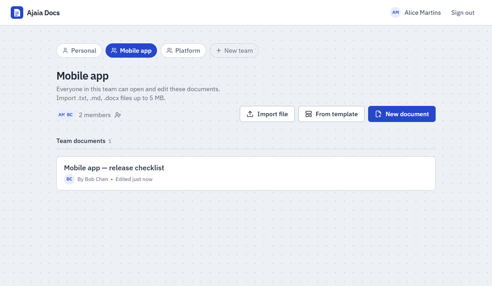 | 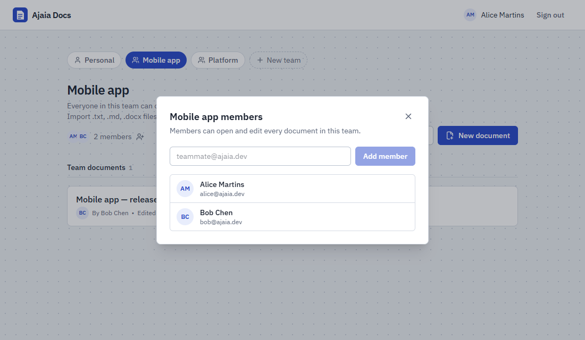 |
| **Writing mode: A4 page with page-break guides** | **Drawing mode: drag a drawing onto the page** |
| 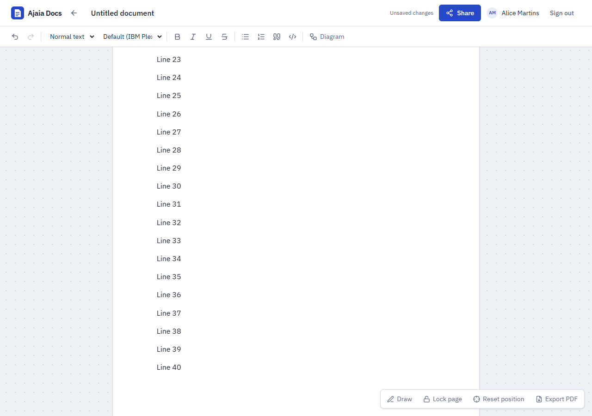 | 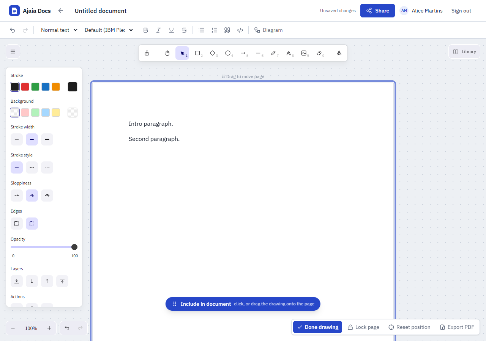 |
| **Canvas: drawings around the page** | **Include / remove toggle** |
| 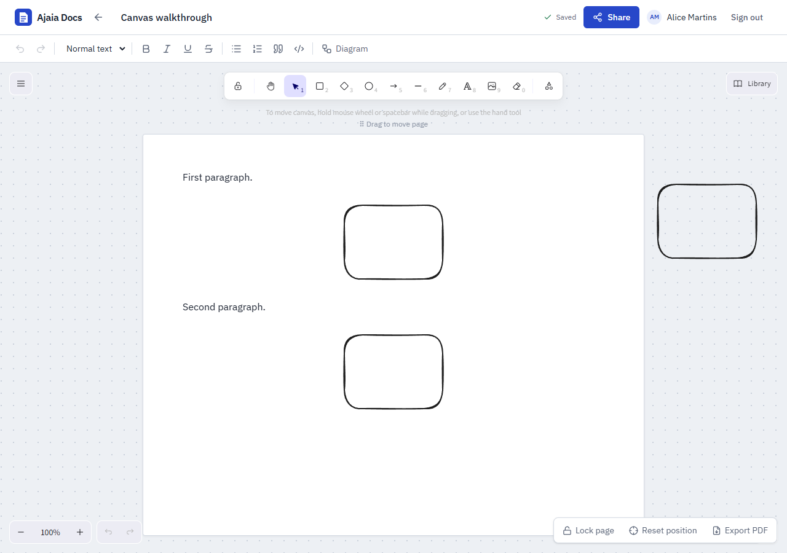 | 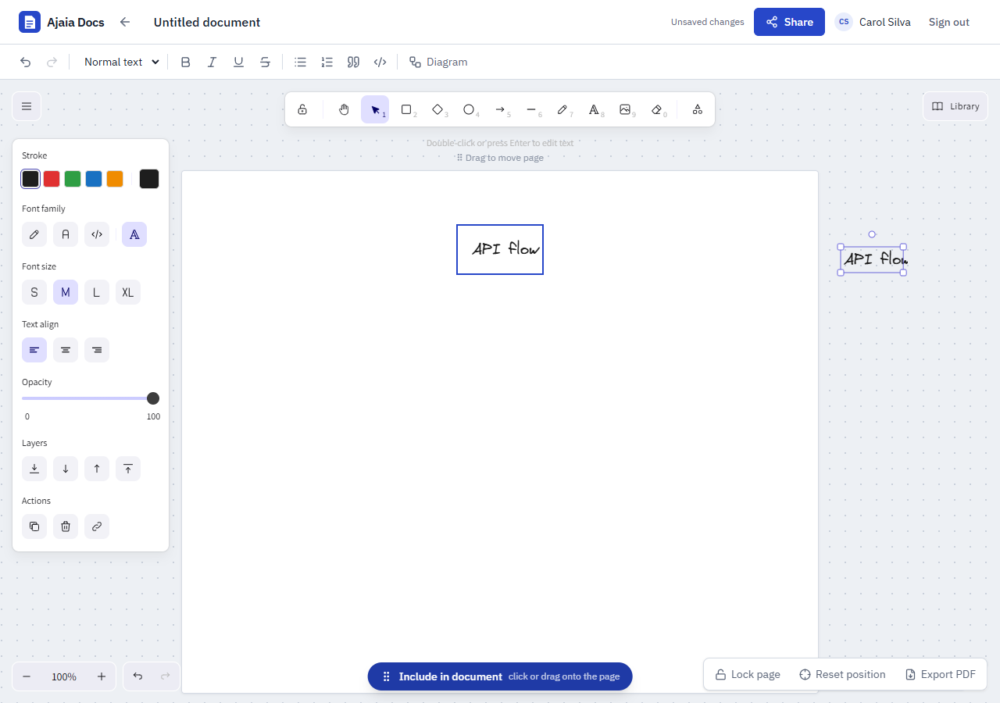 |
| **Templates** | **Mermaid diagrams** |
| 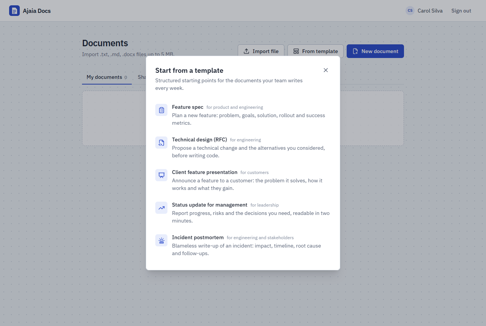 | 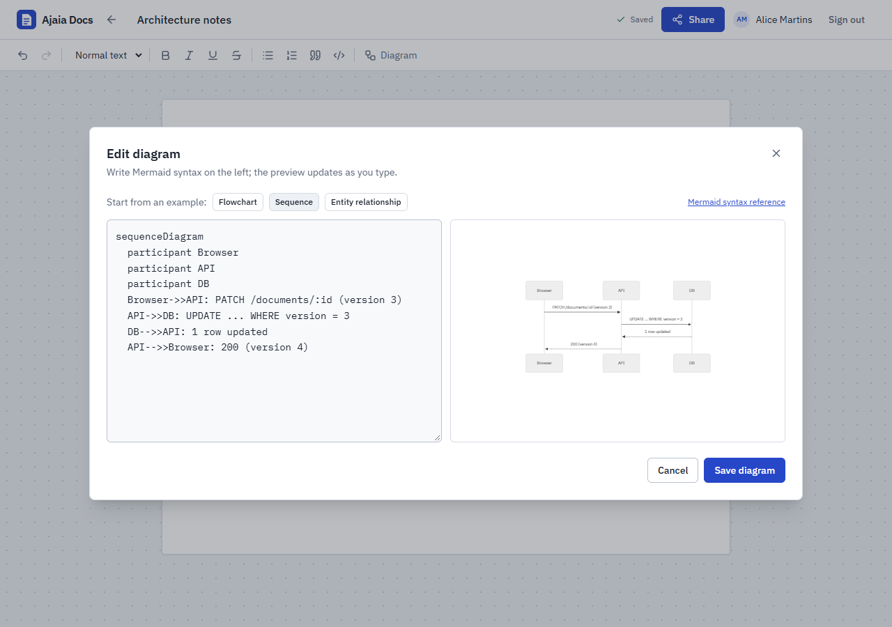 |

## Run locally

Requirements: **Node.js 20+** (22 recommended). No database setup: an embedded Postgres (PGlite) is used when `DATABASE_URL` is empty.

```bash
npm install
npm run dev
```

- Web app: http://localhost:5173
- API: http://localhost:3000

Demo users are seeded on first start. Local data is stored in `apps/api/.data/pglite` (delete the folder to reset).

Production-like run (API serves the built app on one port):

```bash
npm run build
npm start          # http://localhost:3000
```

Configuration: see [`apps/api/.env.example`](apps/api/.env.example) (`DATABASE_URL`, `JWT_SECRET`, `PORT`, `SEED_DEMO_DATA`).

## Run tests

```bash
npm test
```

Runs 108 tests: API unit and integration tests (on an in-memory Postgres) and web unit tests. Details: [docs/testing.md](docs/testing.md).

## API Documentation (Swagger)

The backend API is documented with **Swagger / OpenAPI**. With the app running, open:

- **Local:** http://localhost:3000/api/docs
- **Live:** https://ajaia-docs-hz3d.onrender.com/api/docs

Raw OpenAPI JSON: `/api/docs/json`. To call protected endpoints from Swagger UI, first execute `POST /api/auth/login` (e.g. `alice@ajaia.dev` / `demo1234`); the browser keeps the session cookie.

## Deployment

Everything is defined in [`render.yaml`](render.yaml): one free Render web service (API + static web app) and one free Render Postgres database, wired together automatically.

1. On [Render](https://render.com): **New → Blueprint**, select this repository, **Deploy Blueprint**. No values to fill in.
2. Render creates the database, generates `JWT_SECRET`, builds (`npm ci --include=dev && npm run build`), runs migrations and the seed on startup, and checks `/api/health`.

Free-tier limits: the web service sleeps after ~15 minutes idle (the first request afterwards can take ~50 s), and the free database expires 30 days after creation. To use another Postgres (e.g. Neon, Supabase), set `DATABASE_URL` instead.

## What is not included

Deliberately out of scope for the 4–6 hour timebox:

- **Real-time co-editing and presence** (Yjs/CRDT + WebSockets). Concurrent saves are detected (HTTP 409) and the user is asked to reload instead of merging.
- Comments, suggestions, version history, export to Markdown.
- Real-time merging of canvas edits (the canvas is last-write-wins).
- Sign-up, password reset, organizations. Teams have no roles or member removal yet, and existing documents cannot be moved into a team.
- File attachments and uploading arbitrary images (images come from canvas drawings and .docx imports).

**Next, with 2–4 more hours:** real-time collaboration on the existing editor (Yjs + Hocuspocus, which TipTap supports), version history using the existing `version` column (snapshot per save), export to Markdown, and editable included drawings (keep the Excalidraw scene inside the image node).

## Documentation

| Doc | Contents |
|---|---|
| [Architecture](docs/architecture.md) | What was prioritized and why, system overview, request lifecycle |
| [Decision log](docs/decisions.md) | Each decision with alternatives, tradeoffs and reasoning |
| [Backend](docs/backend.md) | API structure, routes, error contract, security notes |
| [Frontend](docs/frontend.md) | Structure, state, autosave, accessibility, design |
| [Database](docs/database/database.md) | Schema, ER diagram, relationships, indexes, migrations |
| [Testing](docs/testing.md) | Strategy, what each suite proves, running against real Postgres |
| [AI workflow](docs/ai-process.md) | Tools, prompts, what AI sped up, what was changed, verification |
| [Assignment brief](docs/assignment-brief.md) | Original requirements |
| [SUBMISSION.md](SUBMISSION.md) | What is included, test accounts, status |

## Project structure

```
apps/
  api/     Fastify + TypeScript API, Drizzle schema and migrations, tests
  web/     React + Vite + TipTap single-page app
docs/      Architecture, decisions, module docs, ER diagram
render.yaml
```
