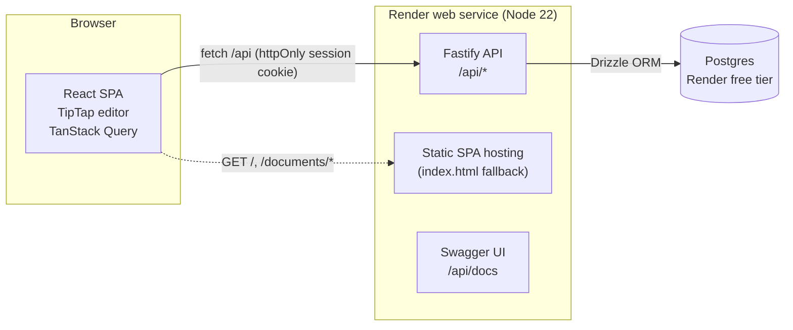

# Architecture

## Product slice

**Ajaia Docs is a lightweight document editor for product and engineering teams.** The brief asks for a Google Docs–inspired tool that helps internal teams move faster; tech teams were chosen as the target because their daily deliverables (feature specs, RFCs, status updates, postmortems) are document-shaped and repetitive.

Priorities, in order:

1. **A complete, reliable core loop:** sign in → create/import → write with formatting → autosave → share → recipient opens it. Every step works end to end, persists, and handles errors explicitly.
2. **Access logic that is correct by construction:** one access rule, enforced on the server, tested through HTTP and SQL.
3. **A deployed build reviewers can use in minutes:** one URL, seeded accounts, no setup.
4. **Tech-team differentiators**, only on top of a working deployed core: document templates for recurring deliverables, then Mermaid diagrams, the canvas, and team workspaces (one person, several projects).

Deliberately not built (see [decisions](./decisions.md) and the README for the full list): real-time co-editing, comments, version history, sign-up.

## System overview

- **One deployable unit.** Fastify serves both the JSON API and the built React app from the same origin: one service, no CORS, cookies just work. Locally, Vite proxies `/api` to the API to reproduce the same-origin setup.
- **Monorepo** with npm workspaces: [`apps/api`](../apps/api) and [`apps/web`](../apps/web). One `npm install`, `npm run dev`, `npm test`.

## Request lifecycle (save)

1. TipTap emits HTML on every change → `useDocumentAutosave` debounces (800 ms) and sends `PATCH /api/documents/:id { contentHtml, version }`.
2. Fastify validates the body with Zod (400 on failure) and verifies the session cookie (401).
3. `loadAccessibleDocument` loads the document, owner and the caller's share in one query and resolves access (404 if none).
4. `canEdit` gates the write (403 for viewers). Content is sanitized.
5. `UPDATE … WHERE id = :id AND version = :version` bumps the version; zero rows updated → 409.
6. The client stores the new version for the next save and updates its cache.

## Module map

| Concern | Where | Notes |
|---|---|---|
| Access rules | `apps/api/src/lib/access-control.ts` | Pure functions, unit-tested |
| Data access + access resolution | `apps/api/src/modules/*/…service.ts`, `document-access.ts` | Services receive the DB handle |
| HTTP contracts | `apps/api/src/modules/*/…routes.ts` | Zod schemas → validation + OpenAPI |
| Content safety | `apps/api/src/lib/sanitize-html.ts` | Allowlist mirrors the editor's features |
| File import | `apps/api/src/modules/imports/` | marked (.md), mammoth (.docx), escaped text |
| Save loop | `apps/web/src/hooks/use-document-autosave.ts` | Debounce, version chaining, conflict handling |
| Team workspaces | `apps/api/src/modules/teams/`, `apps/web/src/pages/DocumentsPage.tsx` | Membership = edit access, resolved in the same query as owner/shares |

Details: [backend](./backend.md) · [frontend](./frontend.md) · [database](./database/database.md) · [testing](./testing.md).

## Known limitations

- **Last-writer protection, not merging.** Two editors typing at the same time do not see each other's changes live; the second save gets a 409 and must reload. Real-time merging (Yjs/CRDT + WebSockets) is the main "next step".
- **Render free tier sleeps** after ~15 minutes idle; the first request can take ~50 s. The UI shows a retry message if the server does not answer.
- Imported `.docx` files lose images and table layout (text is kept).
