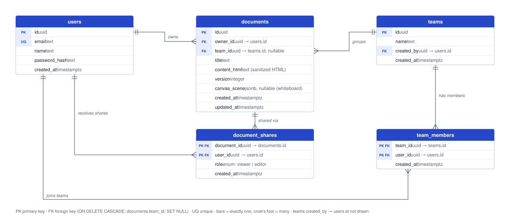

# Database

PostgreSQL, accessed through [Drizzle ORM](https://orm.drizzle.team). Schema source of truth: [`apps/api/src/db/schema.ts`](../../apps/api/src/db/schema.ts).

> The diagram is an SVG with the draw.io model embedded: open it in [diagrams.net](https://app.diagrams.net) to edit, then save over the same file.

## Engines

| Environment | Engine | Why |
|---|---|---|
| Production | Render Postgres (free tier), wired to `DATABASE_URL` by the blueprint | Managed, created with the app in one step, no cost for reviewers |
| Local development | [PGlite](https://pglite.dev) (Postgres compiled to WASM, in-process), stored in `apps/api/.data/pglite` | `npm install && npm run dev` works with no Docker or database setup |
| Automated tests | PGlite in memory (fresh DB per suite), or a real server via `TEST_DATABASE_URL` | Tests run real SQL with constraints and cascades, not mocks |

The same migrations run on both engines at startup (`connectDatabase` in [`client.ts`](../../apps/api/src/db/client.ts)).

## Tables

### `users`
| Column | Type | Notes |
|---|---|---|
| `id` | uuid | PK, `gen_random_uuid()` |
| `email` | text | **unique**, stored lowercase |
| `name` | text | |
| `password_hash` | text | bcrypt (cost 10) |
| `created_at` | timestamptz | |

### `documents`
| Column | Type | Notes |
|---|---|---|
| `id` | uuid | PK |
| `owner_id` | uuid | FK → `users.id`, `ON DELETE CASCADE` |
| `team_id` | uuid, nullable | FK → `teams.id`, `ON DELETE SET NULL`. Team the document was created in; null for personal documents |
| `title` | text | 1–200 chars (validated by the API) |
| `content_html` | text | Sanitized HTML; may embed images as `data:image/*` URIs (see [decisions](../decisions.md#5-store-content-as-sanitized-html)) |
| `version` | integer | Incremented on every write; used for optimistic concurrency |
| `canvas_scene` | jsonb, nullable | Whiteboard around the page: Excalidraw elements, pasted images, page position. Saved separately (last write wins) and excluded from document queries because it can be large |
| `created_at`, `updated_at` | timestamptz | |

Indexes: `documents_owner_id_idx (owner_id)` — "My documents" list; `documents_team_id_idx (team_id)` — a team's documents.

### `document_shares`
| Column | Type | Notes |
|---|---|---|
| `document_id` | uuid | PK (composite), FK → `documents.id`, `ON DELETE CASCADE` |
| `user_id` | uuid | PK (composite), FK → `users.id`, `ON DELETE CASCADE` |
| `role` | enum `share_role` | `viewer` \| `editor` |
| `created_at` | timestamptz | |

Index: `document_shares_user_id_idx (user_id)` — "Shared with me" list. The composite PK already covers lookups by document.

### `teams`
| Column | Type | Notes |
|---|---|---|
| `id` | uuid | PK |
| `name` | text | 1–80 chars (validated by the API) |
| `created_by` | uuid | FK → `users.id`, `ON DELETE CASCADE` |
| `created_at` | timestamptz | |

### `team_members`
| Column | Type | Notes |
|---|---|---|
| `team_id` | uuid | PK (composite), FK → `teams.id`, `ON DELETE CASCADE` |
| `user_id` | uuid | PK (composite), FK → `users.id`, `ON DELETE CASCADE` |
| `created_at` | timestamptz | |

Index: `team_members_user_id_idx (user_id)` — "my teams". The composite PK covers lookups by team.

## Relationships

- A **user owns many documents** (`documents.owner_id`). Ownership is a column, not a share row, so a document always has exactly one owner.
- A **document is shared with many users** through `document_shares`, one row per recipient with a role. Sharing again updates the role (`ON CONFLICT DO UPDATE`).
- Deleting a document removes its shares (cascade).
- A **team has many members** through `team_members` (all members are equal) and **groups many documents** (`documents.team_id`). A document belongs to at most one team. Deleting a team keeps its documents with their owners (`SET NULL`).

## Access rule

Effective access = `owner` if `documents.owner_id = user`, else `editor` if the user is a member of the document's team, else the `role` of the user's share row, else **no access** (the API answers 404). Implemented once in [`access-control.ts`](../../apps/api/src/lib/access-control.ts) and loaded in a single query (document ⨝ owner ⟕ caller's share ⟕ caller's team membership) in [`document-access.ts`](../../apps/api/src/modules/documents/document-access.ts).

## Migrations and seed

- Migrations are generated from the schema: `npm run db:generate -w apps/api` → `apps/api/drizzle/`. They are applied automatically on startup.
- The seed ([`seed.ts`](../../apps/api/src/db/seed.ts)) is idempotent: it creates the three demo users if missing, plus a welcome document owned by Alice and shared with Bob. Demo teams (**Mobile app**: Alice + Bob, **Platform**: Alice + Carol, one document each) are created when no team exists, so they also appear on an existing database. Disable with `SEED_DEMO_DATA=false`.
